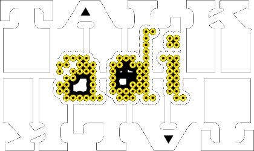
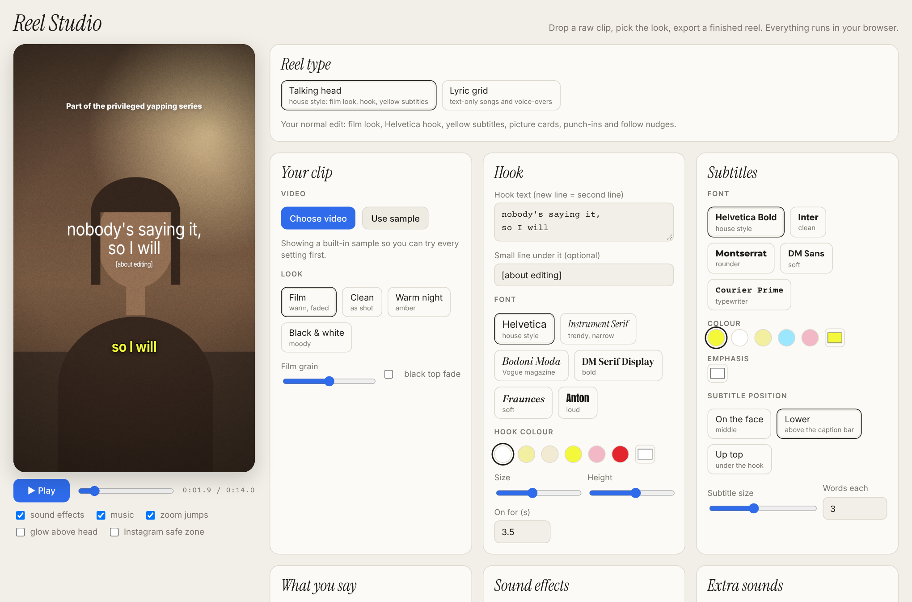
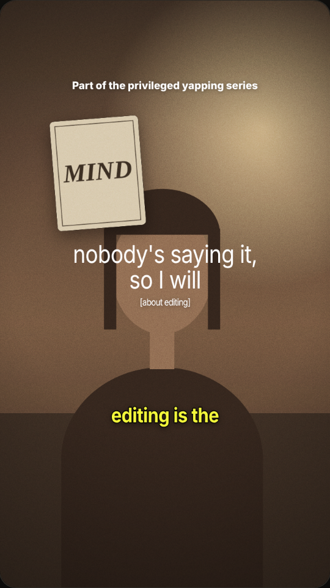
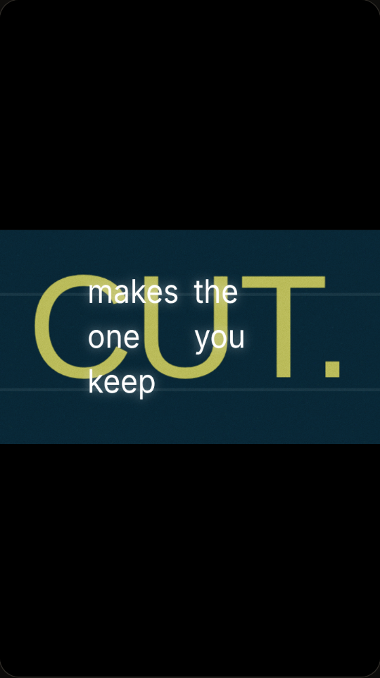
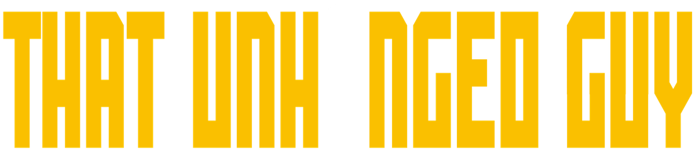

# talkaditalk Reel Studio

**▶ [Open the editor: tripathiadityap.github.io/claudevideoeditor](https://tripathiadityap.github.io/claudevideoeditor/)** · [@talkaditalk](https://www.instagram.com/talkaditalk/) · [@foundayofficial](https://www.instagram.com/foundayofficial/) · [Founday](https://founday-sepia.vercel.app)

**Edit Instagram reels in your browser.** Drop in a raw clip, choose the hook, subtitles, look, sound effects, music and pictures, then export a finished 9:16 reel. You don't install anything, make an account or upload your footage anywhere.

Built by Tripathi Aditya Prakash (Adi, [@talkaditalk](https://www.instagram.com/talkaditalk/)) with Claude, from the same house style I use for my own reels. Made something with it? Tag [@talkaditalk](https://www.instagram.com/talkaditalk/) when you post.

  
  &nbsp;
  

## Try it

Download this repo and open `index.html` in Chrome, Edge or Safari. That's it.

It's live at **[tripathiadityap.github.io/claudevideoeditor](https://tripathiadityap.github.io/claudevideoeditor/)**. The `Deploy to GitHub Pages` workflow republishes it on every push to `main`. If you fork this, set Settings → Pages → Source to **GitHub Actions** and it deploys the same way.

## Reels and YouTube videos

Pick the **format** at the top: **Reel / Short** (9:16), **YouTube** (16:9) or **Carousel** (see below). Everything works in both: hooks, subtitles, looks, pictures, sounds, music, the lyric grid and export. YouTube exports at 1280×720, and **Save YouTube thumbnail** saves the current frame as a 1280×720 PNG, the size YouTube asks for. Use your own video file; the editor doesn't download from YouTube links.

## Animations

Pick **Animation** as the format for motion graphics made entirely in the browser, with no footage. Type your own numbers or words, play it, and export it like a reel (add music if you like).

- **Graph:** a line draws itself while one big number counts up and lands. Your real numbers only.
- **Steps:** minimal line-art steps; a dot hops to the top, an orbit draws around it and the line of text swaps.
- **Map route:** a little city with parks and a river, the route draws while the camera follows, the pin drops, an ETA card counts down to "Arrived" and a trip card shows minutes and distance.
- **Breakdown:** a phone comes apart into labelled layers (glass, screen, frame, board, battery, back). Write your own labels.
- **Stick figure:** a cartoon stick person with expressions, whip transitions and 1 to 2 word captions from your script.
- **What if:** question, what people think, the twist, examples and the payoff, with bold captions and impact hits.

These are lightweight browser versions inspired by [Artem Novitckii's animation skills](https://github.com/artemnovitckii/claude-animation-skills) (MIT). For the full-quality 3D renders, voiceovers and word-timed captions, install those skills in Claude Code and run `/graph`, `/map-route`, `/breakdown`, `/minimalistic-graphics`, `/stick-figure` or `/zach-d-films`.

## Carousels

Pick **Carousel** as the format to build slide posts for Instagram (4:5 or 1:1) and LinkedIn.

- **Layouts:** Cover (big title on a photo), Text, List (numbered points), Quote, Photo + text, and a Follow / save ending with your logo and handle.
- **Styling:** film black, paper white or lemon backgrounds, or a photo with your LUT grade on it. Title fonts and accent colour match the reels, and `*word*` turns a word yellow.
- **Photos:** from your device, your Pinterest board or your saved library. Tap a pin and it becomes the current slide's photo.
- **Every slide:** handle, slide numbers, and a "swipe" cue on the first slide.
- **Export:** **Save all slides** gives a ZIP of full-size PNGs (1080×1350 or 1080×1080) for Instagram. **Save as PDF** makes a LinkedIn document carousel. **Save this slide** saves one PNG.
- Flip slides by tapping either side of the preview, with the arrow keys, or from the slide strip. Right-click (or press and hold) for slide actions.

## Works without Claude

The editor is one HTML file that runs entirely in your browser. On GitHub Pages or a downloaded copy it needs no account, no server and no AI. Two extras only switch on inside claude.ai: hook suggestions written by Claude, and the saved picture library for your phone. Everywhere else they stay hidden and everything else works the same.

## Two styles

### Talking head (house style)
For selfie clips where you talk to camera.

- **Hook**: two lines in Helvetica, Instrument Serif, Bodoni Moda, DM Serif Display, Fraunces or Anton. Choose the colour, size and height, and how long it stays on.
- **Subtitles**: lemon-yellow Helvetica Bold by default, or TV caption style (white monospace capitals with a black outline), Inter, Montserrat, DM Sans or Courier Prime. Wrap a word in `*stars*` and it turns white, the camera punches in, and a sound plays.
- **Looks**: Film (warm, faded, with dust and grain), Clean, Warm night, Black & white. Plus a black top fade and a glow above the head.
- **Zoom jumps** on every caption change, with a bigger push on emphasis words.
- **Follow nudges** ("+ Follow @yourhandle") mid-reel and at the end, plus a series label up top.

### Talking head + lyrics
Your talking-head video with the film look, hook, pictures, punch-ins and follow nudges, but your captions pop into the lyric grid in the lower part of the frame instead of yellow subtitles. Word size and glow come from the Lyric grid card. Auto edit and the timeline work the same way.

### Lyric grid (text-only and voice-overs)
For song reels and voice-overs with no talking head.

- Lowercase Helvetica words pop into a loose four-column grid, each on its beat, and stay until the screen clears.
- Backgrounds: a 16:9 film band on black with a teal film grade, full-frame pictures, plain black, or plain white with black words. Word colour, glow colour, glow size and glow strength can be set separately for words on dark and words on white (Lyric grid card), with a reset button.
- Add the song under Music and the reel runs as long as the song.
- Write `con|scious` to split a word across two columns.

## Colour grades (LUTs)

Real 3D LUTs, applied on your graphics card over the footage, pictures and cards, under the text:

- **Film:** warm, faded, lifted blacks. The house look.
- **Teal film:** blue-black shadows, teal greys, warm skin. The lyric-grid grade.
- **2000s TV:** warm, soft and creamy, like crime dramas from that era.
- **Low exposure:** dark and moody.
- **VHS:** tape colour with lifted blacks, red/blue colour bleed, scanlines, a rolling tracking band and tape noise. Works as the main grade and as the lyric background grade.
- **Teal & orange**, **Kodak warm**, **Moody green**, **Bleach bypass**, **Noir**.
- **Your LUT:** load any 3D `.cube` file (from Resolve, Premiere, Lightroom or a LUT pack), with a strength slider.

Older browsers without WebGL2 get a simpler filter version of each grade.

## Trim & cut

Set where the video starts and ends, and cut bad takes out of the middle. The red and black marks on the timeline show what's removed. Preview and export both skip those parts.

## Timeline

A multi-track timeline under the format picker shows everything in your video: **Video**, **Text** (hook, series label, follow nudges), **Scenes**, **Pictures**, **Captions** (or **Lyrics**), **Sounds**, **Cuts** and **Music**. Drag the hook's right edge to change how long it stays.

- **Drag** a block to move it, **drag its edges** to make it longer or shorter, **click** it to edit it below the timeline, and **click empty space** to jump the playhead there. Zoom in and out with the slider. **Delete** removes the selected block.
- **Scenes** let you mix styles in one video: drop a **lyric grid section** (with its own lyrics) or any animation (**graph, steps, map route, breakdown, stick figure, what if**) between talking-head parts. The video keeps playing underneath and the audio carries on.
- **Add at playhead** adds a scene, caption, sound, picture or cut where the playhead is.
- **Save project / Open project** keeps your edit as a small `.json` file: settings, captions, scenes, sounds, cuts and linked pictures. Videos and uploaded files aren't stored, so add your clip again after opening.

## Auto edit

Paste your script (optional) and press **Auto edit**. It:

- **Cuts the dead air:** finds the pauses in your audio and adds them as cuts. Strictness and shortest-pause sliders included. No AI needed.
- **Times captions to your voice:** on the GitHub Pages version, a small speech model (Whisper tiny, about 40 MB, downloaded once) runs on your own device and times every word. If you pasted your script, your exact spelling is kept. Without the model, for example on the claude.ai link, it lays your script over the parts where you're actually talking.
- **Picks the key word in each line:** it turns yellow, the camera punches in, and the word pops big on screen (turn this off with **word pops**).
- **Writes the hook** from your first line.
- **Places your pictures** on the line whose words match the picture's name, or spreads them across the lines. With no pictures added, it borrows matching pins from your board.
- **Adds a counting graph** when you say a number like "100K" or "50%".

**Undo auto edit** puts everything back. Right-click the preview and choose **Insert animation here** to drop a graph, steps, route or breakdown cutaway anywhere.

## Right-click and press-and-hold

- **Right-click the preview** (or **press and hold** it on your phone) for a quick menu. On a picture: edit, show it from the playhead, switch card/full screen, bring to front, duplicate, remove. Anywhere: play/pause, add a picture or sound right there, start/end/cut at the playhead, save a thumbnail.
- **Hover to preview**: move the mouse over any grade, font, colour or position and the reel shows it live. Move away and it goes back; click to keep it. On a phone, press and hold an option to preview it, then let go.

## Captions, four ways

1. Type them: one line per caption, as `0:01.6 so I will`.
2. Paste plain text and click **Time it automatically**.
3. Click **Tap along**, then tap (or press space) as each caption or word starts. This works best for songs.
4. Load an `.srt` file.

## Pictures

- Add pictures from your device, tap them from your Pinterest board, paste an image link, or drag an image in from another tab.
- **Card** style pops, slides, drops or fades in, floats gently, and can be tilted. Drag it around the preview.
- **Full screen** style is a cutaway. Pictures that aren't 9:16 sit on a blurred copy of themselves, so they're never stretched or cropped badly.

## Sound

- **Built-in sounds**: double click, single click, soft pop, whoosh, light swoosh, sticker slap, camera shutter, riser, bass boom, ding, typewriter and glitch. They're all generated in the browser, so there are no sound files to license.
- **Automatic sounds**: one for when a picture appears, one for emphasis words, one for full-screen pictures and one for each lyric word.
- **Extra sounds**: add as many as you like anywhere on the timeline, and stack them.
- **Your own sounds**: upload MP3/WAV/M4A files and use them anywhere.
- **Music**: add a track and it ducks under your voice automatically.

## Pinterest board

The editor shows pins from [my board](https://in.pinterest.com/tripathiadityap/talditalk-image-repo/). Tap one to drop it into the reel.

- **On GitHub Pages or a local copy**, the board loads live through Pinterest's public board widget feed. That's the newest pins, with nothing to set up.
- **Older pins:** a GitHub Action (`.github/workflows/sync-pinterest.yml`) can also save the board into `pinterest.json` every night, and those show alongside the live pins. Run it any time from **Actions** → *Sync Pinterest* → *Run workflow*.
- **On the claude.ai version (phone)**, Pinterest images can't load, so it has a saved **picture library** instead. Save pins to your phone, tap *Add to library*, and pick as many as you like. They stay saved for next time.
- Pins are linked, not copied. To hide one from the synced list, put its id in `pinterest-exclude.txt`.
- To use your own board, change `BOARD` in `index.html` and `PINTEREST_BOARD` in the workflow.

## Brand kit

Your logos are built into the editor under **Pictures → My logos**: the talk adi talk logo, the dotted adi mark, Founday, ThatUnhingedGuy and The Practitioner. Tap one to drop it into the reel. In **Extras** there's also an optional handle watermark (`@talkaditalk` by default). The files live in `assets/`.

## Export

**Export reel** plays it once from the start and records it with all the sound: 720×1280 for reels, 1280×720 for YouTube. Chrome and Safari save MP4. Browsers that only record WebM need a quick convert before posting from the Instagram app.

Your settings are saved in the browser. Videos, pictures and your own sounds aren't stored, so add them again after a reload.

## Files

| File | What it is |
| --- | --- |
| `index.html` | The whole editor: one file, no build step |
| `pinterest.json` | Pins synced from the board |
| `pinterest-exclude.txt` | Pins to hide |
| `scripts/sync-pinterest.mjs` | The sync script (Node 18+, no dependencies) |
| `.github/workflows/sync-pinterest.yml` | Runs the sync daily |
| `docs/` | Screenshots for this page |
| `assets/` | Logos: talk adi talk, adi mark, Founday, ThatUnhingedGuy, The Practitioner |

## Follow

  
  &nbsp;&nbsp;
  

- Instagram: [@talkaditalk](https://www.instagram.com/talkaditalk/) and [@foundayofficial](https://www.instagram.com/foundayofficial/)
- ThatUnhingedGuy: [Spotify](https://open.spotify.com/show/1DZXqmsDyH2FdJOeBdCoT6) and [YouTube](https://www.youtube.com/playlist?list=PLBBt2c2haxM8)
- Founday on [YouTube](https://www.youtube.com/@foundayoffical)
- The Practitioner on [Substack](https://practitionerhq.substack.com)
- X: [@tripathiadityap](https://x.com/tripathiadityap) · LinkedIn: [Tripathi Aditya Prakash](https://www.linkedin.com/in/tripathiadityaprakash/)
- Founday: [site](https://founday-sepia.vercel.app) and [all links](https://founday-sepia.vercel.app/links)

Founday: Raw Ambition. Unfiltered Mindset. Creative Agency.
